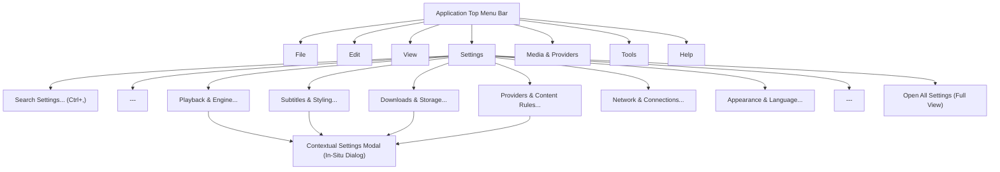
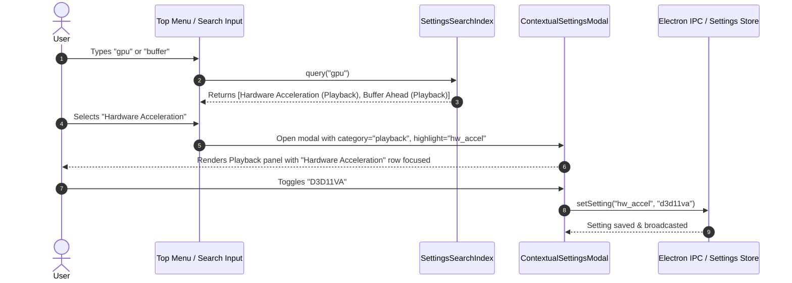

# PRD: Settings Navigation and User Experience Redesign

**Document Status:** Ready for Review  
**Date:** 2026-11-11  
**Target Platform:** Windows-first Electron Desktop (Electron 34+ / React 19 / TypeScript / Vite)  
**Target Audience:** Engineering, UI/UX Design, QA  

---

## 1. Executive Summary & Objective

The current CloudStream 3 Desktop settings interface lives solely within a monolithic tabbed screen (`SettingsView.tsx`). While functionally rich (handling playback engines, provider priority, subtitle aesthetics, download pathways, developer telemetry, caching, and privacy toggles), its organisation suffers from:
1. **Context Switching Friction:** Users wanting to tweak playback or subtitle sync during browsing/navigation are forced to navigate away from their current view.
2. **Monolithic & Cluttered Hierarchy:** Categories mix low-level runtime configurations with high-level user preferences; 40+ setting controls compete across dense tabs.
3. **Lack of In-Situ Discovery:** Users must guess whether an option resides in "General", "Advanced", "Components", or "Sources".

### Objective
Redesign the CloudStream 3 Desktop settings experience to an **enterprise-grade desktop standard** inspired by the modern top-menu and command/quick-access paradigms seen in top-tier desktop tools (such as VS Code), while remaining strictly purpose-built for CS3:
1. **Application-Wide Top Menu Bar:** Introduce a native-feeling in-window top menu bar (File, Edit, View, Settings, Providers/Media, Tools, Help) that gives immediate access to categorized settings.
2. **Contextual Settings Modal / Pop-Up Panels:** Launching settings from the top menu opens an isolated, focused contextual modal/drawer directly over the user's active screen (preserving playback, search, or browsing state) without navigating away or scrolling hackily.
3. **Dedicated Settings Screen Redesign:** Streamline and clean up the full Settings view (`/settings`), grouping options into clear, distinct, functional hierarchies.
4. **Unified Settings Search:** Provide real-time instant search across all settings, keywords, and descriptions from both the top bar (quick open) and within the dedicated settings screen.
5. **100% Component & State Reuse:** Share single-source-of-truth setting components, validation, persistence (`localStorage` & main process `window.cloudstream.setSetting`), and reactivity between modals and the dedicated page.

---

## 2. Problem Statement & Audit of Existing Settings

### 2.1 Current Audit of Settings Components
An audit of `desktop/src/views/SettingsView.tsx` and `desktop/src/components/settings/` reveals the following distributed components and states:

| Existing Area | Current Component(s) | Settings Handled | Pain Points / Flaws |
|---|---|---|---|
| **Player / Playback** | `PlayerSettings.tsx`, `PlaybackTelemetryPanel.tsx`, `PlayerShortcutsPanel.tsx` | Player engine (mpv/video element), hardware acceleration, buffer limits, telemetry, keyboard shortcuts | Mixed across "Player" tab and "Advanced"; telemetry is buried. No quick way to access shortcuts while watching or setting up. |
| **Subtitles** | `SubtitleSettings.tsx` | Fonts, font size, background opacity, colors, auto-download, preferred languages | Crammed under Player or General; difficult to preview live. |
| **Downloads & Storage** | `StoragePanel.tsx`, `SettingsView.tsx` (download directory) | Default folder, confirm before download, auto-delete policy, cache limits, storage quota | Directory picking is separated from cache clearing and disk stats. |
| **Providers & Sources** | `SourceSettings.tsx`, `ProviderRankingPanel.tsx`, `AdultContentSetting.tsx` | Provider priorities, source scraper timeout, adult content toggle, live streams toggle | Provider ranking is complex; adult filter is disconnected from privacy and security. |
| **Network & Proxy** | `NetworkSettings.tsx` | Proxy settings, DoH (DNS-over-HTTPS), connection timeouts, rate limiting | Mixed with developer networking diagnostics. |
| **Backups & Profiles** | `BackupPanel.tsx`, `EraseDataDialog.tsx`, `StartupProfilePanel.tsx` | Full JSON backup, restore review, factory reset | Buried under "Advanced"; high-risk actions mixed with diagnostic logs. |
| **System & Diagnostics** | `DiagnosticsPanel.tsx`, `UnifiedComponentManager.tsx`, `ExtensionIssuesPanel.tsx` | Binary paths (FFmpeg/mpv/JVM), sidecar health, issue logs | Essential troubleshooting tools are hard to locate for ordinary users experiencing errors. |
| **About & Updates** | `AboutPanel.tsx`, `AppUpdateSettings.tsx`, `SupportPanels.tsx` | Update channels (Stable/Beta), version notes, licenses, GitHub links | Dispersed between bottom tabs and modal popups. |

---

## 3. Top Menu Navigation Architecture (Inspiration & Pattern)

Following the design reference, the application top bar (integrated smoothly within the custom desktop window frame or directly below the custom titlebar) provides immediate menu dropdowns.



### 3.1 Menu Bar Specifications
* **Placement:** Positioned at the top of the Electron window chrome, seamlessly aligning with window drag regions and controls.
* **Dropdown Behavior:** Clicking a category opens a high-contrast, accessible flyout menu with keyboard navigation support (Up/Down arrows, Enter, Escape, accelerator keys `Alt+S`, etc.).
* **Contextual Launching (Strict Rule):**
  - Clicking any specific settings menu item (e.g., `Settings > Playback & Engine...`) **MUST NOT** navigate to the dedicated Settings page (`activeTab = 'settings'`).
  - It **MUST** mount a contextual modal/drawer (`<SettingsModal targetCategory="playback" />`) directly on top of the active viewport.
  - The underlying state (video playback, search results, library view) remains completely untouched and active.

---

## 4. Reorganized Information Architecture (IA)

To eliminate unnecessary fragmentation, settings are grouped into **7 clear, logical categories**.

```mermaid
classDiagram
    class ApplicationSettings {
        +Playback & Engine
        +Subtitles & Audio
        +Downloads & Storage
        +Providers & Content Rules
        +Appearance & Interface
        +Network & Security
        +System, Backup & Diagnostics
    }

    class PlaybackAndEngine {
        Default player engine (mpv / HTML5 video)
        Hardware video decoding (D3D11VA / QSV / Auto)
        Buffer ahead threshold & seek intervals
        Auto-play next episode
        Playback telemetry & performance logging
    }

    class SubtitlesAndAudio {
        Subtitle styling (font, size, background, color)
        Default subtitle language & secondary tracks
        Auto-fetch subtitles from OpenSubtitles
        Audio track language priority & normalization
    }

    class DownloadsAndStorage {
        Download destination directory
        Prompt before downloading
        Torrent storage directory & caching limits
        Post-download actions & file deletion behavior
        Clear cached artwork & temp data
    }

    class ProvidersAndContentRules {
        Provider ranking & custom priority order
        Scraper timeout & parallel source resolution
        Adult / 18+ content toggle & PIN protection
        Live stream & mirror link filters
    }

    class AppearanceAndInterface {
        UI Theme (Dark / OLED / System)
        Experience level (Standard vs. Developer mode)
        Home screen row visibility & catalog ordering
        Card status legends & badging
    }

    class NetworkAndSecurity {
        Proxy configuration (HTTP / SOCKS5)
        DNS-over-HTTPS (Cloudflare / Quad9 / Custom)
        Request concurrency limits & timeouts
        Incognito / privacy session defaults
    }

    class SystemBackupAndDiagnostics {
        App update channel (Stable / Beta)
        JVM Sidecar, FFmpeg & mpv binary paths
        Full JSON configuration export & import
        Startup profiling & diagnostic logs
        Factory reset / cache wipe
    }

    ApplicationSettings --> PlaybackAndEngine
    ApplicationSettings --> SubtitlesAndAudio
    ApplicationSettings --> DownloadsAndStorage
    ApplicationSettings --> ProvidersAndContentRules
    ApplicationSettings --> AppearanceAndInterface
    ApplicationSettings --> NetworkAndSecurity
    ApplicationSettings --> SystemBackupAndDiagnostics
```



---

## 5. Unified Settings Search Engine

### 5.1 Search Requirements
- **Instant Filtering:** Real-time query matching with a debounce of ≤ 50ms (in-memory keyword index).
- **Comprehensive Indexing:** Every setting has a schema entry:
  - `id`: Unique key.
  - `title`: Display name (e.g., "Hardware Acceleration").
  - `category`: Parent category name.
  - `keywords`: Common synonyms (e.g., "gpu", "decoding", "d3d11va", "transcoding", "smooth", "lag").
  - `description`: Explanatory text.
  - `component`: React node or component reference.
- **Result Presentation:**
  - Highlights matching terms.
  - Displays breadcrumb path (`Settings > Playback & Engine > Hardware Acceleration`).
  - Clicking a result in the search dropdown opens the setting in the contextual modal with that specific row highlighted/pulsed.



---

## 6. Component Reusability & Architecture

To avoid duplicating UI or creating parallel settings logic, all settings sections will be refactored into **pure, headless/presentational panels**.

### 6.1 Architectural Pattern
```
desktop/src/
├── components/settings/
│   ├── panels/
│   │   ├── PlaybackSettingsPanel.tsx
│   │   ├── SubtitleSettingsPanel.tsx
│   │   ├── DownloadSettingsPanel.tsx
│   │   ├── ProviderSettingsPanel.tsx
│   │   ├── AppearanceSettingsPanel.tsx
│   │   ├── NetworkSettingsPanel.tsx
│   │   └── SystemDiagnosticsPanel.tsx
│   ├── modal/
│   │   ├── ContextualSettingsModal.tsx     <-- Used by Top Menu Bar
│   │   └── SettingsSearchPalette.tsx       <-- Quick search popup / palette
│   ├── registry/
│   │   └── settingsRegistry.ts             <-- Centralized definitions, schema & search index
│   └── SettingRow.tsx
├── views/
│   └── SettingsView.tsx                    <-- Dedicated full screen (embeds panels)
└── components/
    └── TopMenuBar.tsx                      <-- Top navigation menu bar
```

### 6.2 Data Flow & Synchronization
1. **Single Source of Truth:** All panels read and write directly to `window.cloudstream.getSetting` / `setSetting` and listen to the global `settings-changed` event.
2. **Synchronous Reactivity:** Modifying a setting in `ContextualSettingsModal` dispatches the update event, immediately updating the dedicated `SettingsView` if mounted, and vice versa.
3. **No Drift:** No panel has its own isolated persistent state.

---

## 7. UX & Interaction Details

### 7.1 Contextual Modal Behavior
- **Sizing & Positioning:** Centered modal with a clean backdrop overlay (blur: 4px), width `720px`, max-height `80vh`.
- **Keyboard Trapping & Shortcuts:**
  - `Escape`: Closes the modal.
  - `Tab` / `Shift+Tab`: Focus cycles within the modal controls.
  - Focus is restored to the initiating menu item upon close.
- **Tab Switching within Modal:** If a user opens "Playback Settings" but realizes they also need "Subtitles", the left sidebar of the modal allows 1-click switching to any other category without closing and reopening.

### 7.2 Dedicated Settings Screen Enhancements
- Left navigation rail with category icons, search bar at the top, and experience mode toggle (Standard / Developer).
- Clean section cards with clear explanations, status indicators, and immediate feedback (toast / flash indicator).
- Responsive layout adapting to window resizing from standard desktop resolutions (1024×768) to 4K displays.

---

## 8. Acceptance Criteria

1. **Top Menu Bar:**
   - [ ] Top menu bar is permanently visible (or accessible via standard menu patterns) without obstructing playback full-screen mode.
   - [ ] Menu items provide direct triggers for all 7 settings categories.
2. **In-Situ Contextual Modal:**
   - [ ] Opening any setting from the top menu displays a contextual modal dialog over the current screen.
   - [ ] Clicking a top menu setting **never** performs a page redirect to `/settings` or uses a scrolling hack on the full settings page.
   - [ ] Modal can be closed with `Esc`, outside click, or the close button, preserving the user's background page state (playback, search results, etc.).
3. **Dedicated Settings Screen:**
   - [ ] Redesigned information architecture groups all existing options into the 7 defined categories.
   - [ ] Retains the ability to switch experience modes (Standard vs. Developer).
   - [ ] Zero loss of existing settings, toggles, or diagnostic capabilities.
4. **Unified Search:**
   - [ ] Search input available in both the top navigation bar and the dedicated settings page.
   - [ ] Search indexes names, descriptions, and synonym keywords with instant filtering.
   - [ ] Selecting a search result opens/focuses the target setting immediately.
5. **Architectural Integrity:**
   - [ ] Configuration panels are shared between the modal and the dedicated settings screen.
   - [ ] Settings values persist seamlessly via existing IPC channels.
   - [ ] All TypeScript types compile strictly with `node_modules/.bin/tsc -b`.

---

## 9. Rollout & Migration Plan

1. **Phase 1: Settings Schema & Panel Decoupling:** Extract settings panels from `SettingsView.tsx` into standalone modular components (`desktop/src/components/settings/panels/`).
2. **Phase 2: Settings Registry & Search Index:** Build `settingsRegistry.ts` mapping IDs, keywords, categories, and components.
3. **Phase 3: Contextual Settings Modal:** Implement `ContextualSettingsModal.tsx` supporting category selection and direct item focus.
4. **Phase 4: Top Menu Bar Integration:** Integrate `TopMenuBar.tsx` into the application chrome, hooking menu commands to modal actions.
5. **Phase 5: Dedicated Settings Screen Overhaul:** Re-assemble `SettingsView.tsx` using the decoupled panels and improved information architecture.
6. **Phase 6: Verification & Automated Testing:** Unit tests for search index matching, keyboard navigation, and IPC synchronization.
