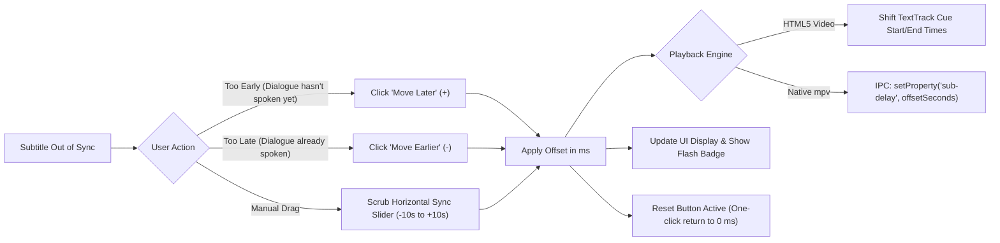
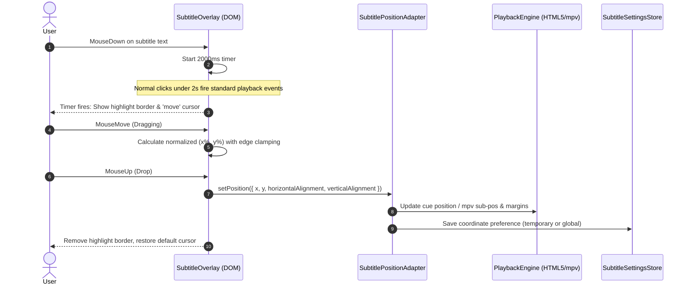
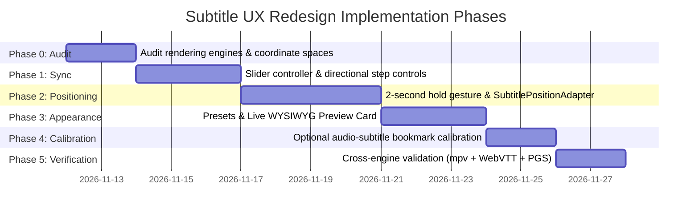

# PRD: Subtitle Module UX & Interactive Controls Redesign

**Document Status:** Ready for Review  
**Date:** 2026-11-11  
**Target Platform:** Windows-first Electron Desktop (Electron 34+ / React 19 / TypeScript / Vite / mpv & HTML5 Video)  
**Target Audience:** Engineering, UI/UX Design, QA  

---

## 1. Executive Summary & Objective

CloudStream 3 Desktop already features an established subtitle foundation:
- In-player subtitle search & management (`SubtitlePanel.tsx`).
- Subtitle normalization and conversion to WebVTT (`convert.ts`).
- Dedicated persistent subtitle library (`subtitleLibrary.ts`).
- Cross-engine appearance definitions (`subtitleStyle.ts` supporting both HTML5 `::cue` CSS variables and native mpv client properties).
- Timing offset handling via keyboard shortcuts and numeric inputs.

However, the current user experience requires viewers to manually calculate timing delays in milliseconds, change numeric lifting coordinates, and navigate nested menus to tweak appearance. 

### Core Objectives
Transform the subtitle workflow into a **first-class, visual, direct-manipulation user experience** organized around three key user tasks:
1. **Visual Timing Synchronisation:** Replace raw numeric entry with an intuitive bidirectional timeline slider with human-readable labels ("Earlier" / "Later"), fine/coarse quick steps, and an optional bookmark-based audio calibration workflow.
2. **Direct Subtitle Drag & Position:** Enable viewers to move subtitles directly across the video frame using an intentional 2-second hold-and-drag gesture, backed by a normalized coordinate system (`SubtitlePositionAdapter`) for both HTML5 `<video>` and native `mpv`.
3. **Interactive Appearance Customisation & Live Preview:** Provide real-time WYSIWYG preset selection (Default White, Dark Box, High Contrast, Soft Shadow) with live property adjustments and explicit communication of engine/format limitations (e.g. image-based PGS/VOBSUB vs text WebVTT/SRT).
4. **Scoped Persistence:** Differentiate between temporary per-session sync corrections and persistent global appearance preferences.

---

## 2. Research & Cross-Player Benchmarking

| Player | Benchmark Interaction | CS3 Architectural Translation |
|---|---|---|
| **VLC Media Player** | Keyboard hotkeys (`G`/`H`) for fine offset; Audio/Subtitle bookmark calibration | Implement bidirectional slider with 50ms / 100ms / 250ms steps + optional cue bookmark calibration |
| **Kodi** | On-screen playback overlay controls; persistent positioning & styling | Dedicated floating in-player subtitle panel with live feedback on actual video canvas |
| **Plex** | Clean relative offset adjustments (+/- 50ms & 100ms) with zero math | "Subtitles appear too early" → move later; "Subtitles appear too late" → move earlier |
| **mpv** | Native runtime properties (`sub-delay`, `sub-pos`, `sub-font-size`, `sub-margin-y`) | Unified `SubtitlePositionAdapter` and `SubtitleStyle` syncing across HTML5 and mpv |

### Crucial Technical Reality: Engine & Format Boundaries
Subtitles in CS3 arrive in multiple formats:
- **Text-based cues:** WebVTT, SRT, ASS/SSA (when decoded via libass). Full support for styling, offset, and dragging.
- **Image-based bitmapped cues:** PGS (`hdmv_pgs_subtitle`), VOBSUB (`dvd_subtitle`). Rendered as pre-baked pixel bitmaps. Positioning and styling overrides cannot be arbitrarily applied.
- **ASS/SSA Styled Streams:** Contain hard-coded position coordinates and vector font styling. Overriding position or fonts must clearly state when native script styles take precedence.

> **Rule:** If a format or active engine cannot support visual dragging or styling overrides, the UI must gracefully disable the control and display an explanatory badge (e.g., *"Bitmap subtitle (PGS): appearance & free drag locked"*), rather than rendering a fake preview that fails to reflect reality.

---

## 3. Subtitle Timing Synchronisation Architecture



### 3.1 Visual Sync Controller Specifications
- **Central Slider:** Centered horizontal slider (`-10.0s` to `+10.0s`). Center tick is marked `0 ms`.
- **Directional Clarity:**
  - Left step button: `◀ Move Earlier` (subtracts offset, corrects subtitles appearing after voice).
  - Right step button: `Move Later ▶` (adds offset, corrects subtitles appearing before voice).
- **Stepping Granularity:**
  - `Fine`: 50 ms (for minor lip-sync drift).
  - `Normal`: 100 ms (default single-click step).
  - `Coarse`: 250 ms (for rough sync matching).
- **Instant Live Application:** Adjusting the slider or clicking step buttons applies the delta immediately to the active player without pausing or reloading the video.
- **One-Click Reset:** Always-present `Reset (0 ms)` button immediately returns the offset to zero.

### 3.2 Optional Synchronisation Calibration Mode (Bookmark Workflow)
For files with unknown or large offsets:
1. **Step 1 (Audio Marker):** User presses `Mark Dialogue` at the moment a distinct word is spoken. CS3 captures `t_audio = currentTime`.
2. **Step 2 (Cue Marker):** User pauses or scrubs to the corresponding subtitle line in the cue list and clicks `Mark Subtitle`. CS3 captures `t_sub = cue.startTime`.
3. **Step 3 (Auto-Computation):** CS3 computes `offset = t_audio - t_sub`, applies it to the preview, and prompts `Apply Calibration`.

---

## 4. Interactive Direct Subtitle Dragging & Positioning

### 4.1 Long-Press Activation Gesture
To avoid conflicting with video controls, seeking, or double-click fullscreen:
1. **Hover:** Mouse pointer hovers over the active subtitle bounding box on the video overlay.
2. **Press & Hold (2 Seconds):** User clicks and holds the mouse button down for 2000 ms.
3. **Visual Confirmation:** 
   - A pulsing cyan/accent outline surrounds the subtitle text box.
   - Cursor changes to `move`.
   - A small floating pill indicator appears: *"Positioning Mode — Drag to move, Esc to cancel"*.
4. **Drag:** User moves mouse; the subtitle box follows the pointer smoothly within defined screen margins.
5. **Snap-to-Grid & Safe Margins:**
   - Magnetic snap when within 16px of horizontal center (`x = 50%`).
   - 5% safe padding from screen edges (preventing clipping off-screen or under system taskbars).
6. **Release & Save:** Releasing the mouse button persists the new coordinates and dismisses the positioning frame.



### 4.2 Alternative UI Positioning Sliders
Beside direct dragging, the Subtitle Control Panel exposes visual sliders:
- **Vertical Position:** Slider from `0%` (bottom frame default) to `90%` (top of frame).
- **Horizontal Alignment:** Segmented toggle: `Left`, `Center`, `Right`.
- **Reset Position:** Returns to standard bottom-center (`x = 50%, y = 0%`).

### 4.3 Normalized Coordinate System
Positions are stored as normalized percentage vectors (`0.0` to `1.0`), independent of physical pixel dimensions:
```typescript
export interface SubtitlePosition {
  /** Horizontal anchor: 0.0 (left) to 1.0 (right), 0.5 = center */
  x: number;
  /** Vertical distance from bottom edge: 0.0 (bottom) to 1.0 (top) */
  y: number;
  horizontalAlignment: 'left' | 'center' | 'right';
  verticalAlignment: 'bottom' | 'center' | 'top';
}

export interface SubtitlePositionAdapter {
  getPosition(): SubtitlePosition;
  setPosition(pos: SubtitlePosition): Promise<void>;
  resetPosition(): Promise<void>;
  supportsDirectPositioning(): boolean;
}
```

---

## 5. Subtitle Appearance, Styling & Live Preview

### 5.1 Ready-to-Use Presets
Four instant visual presets covering 98% of viewer needs:
1. **Default White (Outline):** Pure white text (`#ffffff`), 1.0x scale, 4-way solid dark outline. High legibility without background letterboxing.
2. **Dark Box (Cinema):** White text on `rgba(0, 0, 0, 0.75)` semi-transparent rounded rectangular box. Maximum readability over brightly lit scenes.
3. **High Contrast Yellow:** Vibrant yellow text (`#f2e14c`), bold weight, thick black outline (`#000000`). Recommended for accessibility and anime/foreign releases.
4. **Soft Shadow:** Off-white text (`#d7dae0`), soft blurred drop shadow (`0 2px 4px rgba(0,0,0,0.9)`), clean, minimal intrusion.

### 5.2 Granular Appearance Controls
- **Font Scale:** Slider from `0.75x` to `2.0x` (with 0.05 step resolution).
- **Font Weight:** `Normal (400)` vs `Bold (700)`.
- **Text Color:** Preset swatch palette + custom hex picker.
- **Background Mode:** `Outline`, `Shadow`, `Box`, or `None`.
- **Background Opacity:** Slider (`0%` to `100%`) when `Box` is active.
- **Line Spacing:** Compact (`1.1`), Normal (`1.3`), Spacious (`1.5`).

### 5.3 Live WYSIWYG Preview Box
The Subtitle Panel features an integrated live preview card rendering sample dialogue:
> *"The quick brown fox jumps over the lazy dog."*  
> *"Synchronized at 23.976 fps."*

The preview renders against a split dark/light checkerboard backdrop, ensuring the viewer can evaluate outline separation and contrast immediately without leaving the panel.

---

## 6. Subtitle Control Panel Layout & Interaction Design

The player's in-flight subtitle modal (`SubtitlePanel.tsx`) is structured into four distinct, collapsible cards:

```
┌────────────────────────────────────────────────────────┐
│  SUBTITLES & CAPTIONS                         [X Close]│
├────────────────────────────────────────────────────────┤
│  [Tracks & Sources] [Sync] [Position] [Appearance]     │
├────────────────────────────────────────────────────────┤
│  [CARD 1: ACTIVE TRACK]                                │
│  • Track: [ English [CC] - Provider (OpenSubtitles) ▼] │
│  • Download External Subtitle (.srt / .vtt)            │
├────────────────────────────────────────────────────────┤
│  [CARD 2: SYNCHRONISATION]                             │
│  Current Offset: +150 ms                               │
│  [ ◀ Move Earlier ]   [ 0 ms Reset ]   [ Move Later ▶ ]│
│  ◄───────────────|─────●─────────────────────────────► │
│  -10.0s                0 ms                    +10.0s  │
│  Step: ( ) Fine (50ms)  (•) Normal (100ms)  ( ) 250ms  │
├────────────────────────────────────────────────────────┤
│  [CARD 3: POSITIONING]                                 │
│  Align: [ Left ] [• Center ] [ Right ]                 │
│  Vertical Lift: ──────●──────────── (15%)              │
│  [ Hold subtitle on video for 2s to drag freely ]      │
├────────────────────────────────────────────────────────┤
│  [CARD 4: APPEARANCE & PRESETS]                        │
│  Presets: [ White Outline ] [ Dark Box ] [ Yellow ]    │
│  ┌──────────────────────────────────────────────────┐  │
│  │ Live Preview: "Here is sample subtitle dialogue" │  │
│  └──────────────────────────────────────────────────┘  │
│  Text Size: ──────●──────────── (1.15x)                │
│  [ Advanced Appearance Options ▼ ]                     │
└────────────────────────────────────────────────────────┘
```

---

## 7. Configuration Scopes & Persistence Rules

| Setting | Default Lifetime | Scope Options | Persistence Target |
|---|---|---|---|
| **Timing Offset (ms)** | Playback Session Only | Session / Per-Video ID | Stored in active video state; optionally remembered per specific video file / torrent hash. Never applied globally to all media. |
| **Subtitle Position (x, y)** | Global User Preference | Global / Per-Display | Saved to `window.cloudstream.setSetting('subtitle_position', ...)` |
| **Appearance & Presets** | Global User Preference | Global Default | Saved to `window.cloudstream.setSetting('subtitle_style', ...)` |
| **Active Language Priority** | Global User Preference | Global Default | Saved to `window.cloudstream.setSetting('preferred_subtitle_languages', ...)` |

---

## 8. Cross-Engine Capability Matrix

| Feature | HTML5 Video (`<video>` + WebVTT) | Native Engine (`mpv`) | Bitmap Subtitles (PGS/VOBSUB) |
|---|---|---|---|
| **Timing Delay** | Supported (cue timestamp recalculation) | Supported (`sub-delay`) | Supported (stream demux offset) |
| **Direct Drag / Reposition** | Supported (CSS `transform` / `top` / `left`) | Supported (`sub-pos`, `sub-margin-y`) | Unsupported (Fixed picture coordinates) |
| **Font Scaling** | Supported (`::cue { font-size }`) | Supported (`sub-font-size`) | Unsupported |
| **Color & Outline** | Supported (`::cue { color, text-shadow }`) | Supported (`sub-color`, `sub-border-color`) | Unsupported |
| **Live WYSIWYG Preview** | 100% Fidelity | 100% Match via shared token model | Disabled (Badged as Bitmapped stream) |

---

## 9. Implementation Roadmap & Phases



1. **Phase 0: Architecture & Engine Auditing:**
   - Formalize `SubtitlePositionAdapter` interface in `desktop/src/utils/subtitleStyle.ts`.
   - Implement format capability detection (flagging bitmap PGS/VOBSUB tracks).
2. **Phase 1: Visual Synchronisation Controller:**
   - Build `SubtitleSyncSlider.tsx` with `-10s` to `+10s` range, fine/coarse toggles, and zero-reset.
   - Wire immediate non-blocking offset updates to `VideoPlayer.tsx` and mpv IPC.
3. **Phase 2: Direct Interactive Positioning:**
   - Add pointer long-press listener (2s threshold) to `SubtitleOverlay.tsx`.
   - Render positioning boundaries and snap lines.
   - Synchronize position coordinates across `<track>` cues and mpv margins.
4. **Phase 3: Visual Appearance Presets & Live Preview:**
   - Implement ready-to-use style cards in `SubtitlePanel.tsx`.
   - Add interactive live preview box with split-contrast backdrop.
5. **Phase 4: Audio Bookmark Calibration Mode:**
   - Implement quick bookmarking flow for syncing audio timestamps to subtitle cue text.
6. **Phase 5: Cross-Engine & Regression Verification:**
   - Test under both HTML5 player and embedded native mpv.
   - Ensure existing OpenSubtitles search and companion auto-loaders remain unaffected.

---

## 10. Acceptance Criteria

- [ ] **Sync Slider:** Users can adjust timing via a visual slider (`-10s` to `+10s`) without entering numbers.
- [ ] **Human-Readable Direction:** UI explicitly indicates *"Move Earlier"* vs *"Move Later"*.
- [ ] **Instant Feedback:** Timing offset updates live audio/video without pausing or restarting playback.
- [ ] **Direct Dragging:** Holding mouse on active subtitle for 2 seconds activates positioning mode; dragging relocates subtitle smoothly.
- [ ] **No False Triggers:** Normal clicks, text selection, or scrubbing on the seekbar never accidentally trigger positioning mode.
- [ ] **Window Resizing Resilience:** Subtitle position remains consistent when toggling fullscreen or resizing window (normalized percentage coordinates).
- [ ] **Presets & Live Preview:** All 4 style presets update the subtitle appearance immediately; live preview accurately depicts outlines, colors, and box opacity.
- [ ] **Graceful Degrade on Bitmaps:** PGS/VOBSUB tracks cleanly disable unsupported appearance/positioning controls with clear explanatory tooltips.
- [ ] **Persistence Boundaries:** Subtitle timing delays do not inadvertently leak into unrelated videos or media items.
- [ ] **Code Quality:** Fully typed in TypeScript, compiling cleanly with `node_modules/.bin/tsc -b`.
