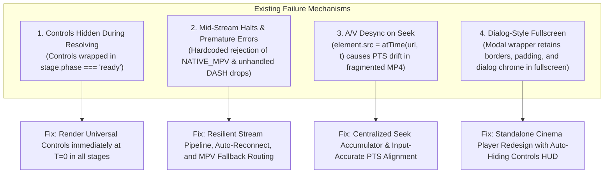

# PRD-56: Unified Movie and TV Trailer Discovery, Search, and Playback

**Project:** CS3 Desktop  
**Feature:** Trailer, Teaser, Promotional Clip & Documentary Discovery Engine & High-Reliability Playback Architecture  
**Document Status:** Proposed (Open Work Register)  
**Document ID:** PRD-56  
**Creation Date:** November 2026  
**Priority:** High  
**Platform:** Windows-first desktop (`desktop`), with cross-platform desktop portability (macOS/Linux)  
**Compatibility:** Additive desktop capability. Strict zero-regression guarantee for existing search providers and Android `.cs3` extension ecosystem.

---

## 1. Executive Summary & Objective

Build a unified, high-performance trailer and promotional-video discovery feature that allows users to search, discover, preview, organize, and watch publicly available trailers, teasers, clips, featurettes, behind-the-scenes footage, and promotional documentaries for movies, TV series, and anime.

In addition to discovery, this specification delivers a **complete architectural overhaul and fix for trailer playback reliability, immediate player controls, cinema-grade fullscreen UI redesign, and timeline audio/video synchronization**.

### 1.1 The Core Operating Principle: Chip-Gated Discovery vs. Standard Search

To preserve the absolute stability, performance, and predictability of CS3's core media scraping engine, **trailer and promotional metadata discovery is strictly chip-gated in the search interface**:

1. **Default Mode (No Trailer Chip Selected):**
   - Search operates **100% as it does today**.
   - Input queries are routed exclusively to existing CS3 scrapers, installed `.cs3` community extensions in the JVM sidecar, Cinemeta/TVmaze/AniList title autocomplete, and local library/history.
   - Zero trailer-specific API traffic, zero quota consumption, and zero latency overhead are introduced to standard movie/show search.
2. **Trailer & Promotional Mode (User selects the "Trailers" / "Trailers & Clips" chip on the search bar):**
   - The search bar switches into dedicated promotional discovery mode.
   - The search engine independently queries publicly available APIs and open video platforms (TMDB, YouTube, Dailymotion, IMDb public feeds, Vimeo, Wikidata, AniList).
   - Any query typed by the user—whether a full title (`Spider-Man: No Way Home`), a partial prefix (`Spider`, `spi`), a phonetic spelling or typo (`an hull` for The Incredible Hulk), a long multi-word query (even a 1000-word descriptive plot/character query), or general promotional keywords (`upcoming anime trailers 2026`, `Christopher Nolan behind the scenes`)—initiates an independent search for relevant promotional videos, teasers, clips, featurettes, documentaries, and interviews.
3. **Detail Page Integration (Title-Specific Promotional Media):**
   - When a user opens any movie or TV series detail page, a dedicated "Trailers & Promotional Media" section displays all curated promotional videos associated with that canonical title, organized by category (Official Trailers, Teasers, Clips, Featurettes, Behind-the-Scenes).
4. **Flawless Playback Experience:**
   - Immediate player controls from T=0 (visible during resolving and buffering).
   - High-reliability continuous streaming with zero unexpected mid-stream dropouts or spurious "Video is not streamable or playable" errors.
   - Timeline seeking with frame-accurate audio/video synchronization.
   - True standalone fullscreen player experience replacing the modal dialog aesthetic.

---

## 2. Existing CS3 Architecture & Codebase Reuse

Before adding new systems, we audit and extend the existing foundation documented in `AGENTS.md` and live in the codebase:

| Module / Component | Existing Responsibility | Planned Extension in PRD-56 |
|---|---|---|
| `desktop/src/components/Navbar.tsx` | Search bar input, query submission, clear button, scope badge, `.torrent` attachment | Add the persistent `Trailers` category chip toggle inside the search input bar. When active, placeholder and submit route to trailer discovery. |
| `desktop/src/utils/searchCategories.ts` | Definition of `SEARCH_CATEGORIES` (`title`, `cast`, `director`, `writer`, `producer`, `composer`, `studio`) | Add `trailer` (`Trailers & Clips`) category definition, scope serialization, and filter predicates (`wantsTrailers(categories)`). |
| `desktop/src/components/SearchSuggestions.tsx` | Dropdown panel below search input rendering category chips, history, and autocomplete | Display the `Trailers` chip in the suggestion header. Offer trailer-specific autocomplete suggestions when trailer mode is active. |
| `desktop/electron/metadata/videoTitles.ts` | Regex & heuristic classification of video titles (`kind`, `label`, `season`, `ordinal`, official publisher detection) | Expand classification grammar to recognize promotional documentaries, TV spots, casting tapes, and international dub trailers. |
| `desktop/electron/metadata/youtube.ts` | Keyless YouTube oEmbed metadata lookup (`title`, `author_name`, `thumbnail_url`) for known video IDs | Retain for fast, zero-quota validation of discovered YouTube video IDs; implement Dailymotion and Vimeo oEmbed equivalents. |
| `desktop/src/components/detail/TrailerGallery.tsx` | Detail page promotional video gallery | Unify data contract with global trailer search results, supporting multi-category tabs and pagination. |
| `desktop/src/components/detail/TrailerPopup.tsx` | In-app trailer playback modal | Fix controls visibility (render immediately on mount), eliminate PTS drift on seeks, overhaul fullscreen layout, and implement dual-path streaming (compliant embed + direct stream). |
| `desktop/electron/searchSession.ts` | Coalesced streaming search orchestrator for extensions | Provide a parallel, non-blocking `TrailerSearchSession` that streams progressive video results without mutating the core provider search session. |
| `desktop/electron/media/mediaProxy.ts` & `mediaTranscoder.ts` | Local HTTP media streaming & transcoding proxy | Fix PTS clock offset alignment on `?t=` seeking to eradicate audio/video desynchronization. |

---

## 3. User Experience & Interface Specifications

### 3.1 Search Bar Chip Integration

The primary entry point for trailer discovery is a dedicated chip on the universal search bar.

```text
+-------------------------------------------------------------------------------------------------------+
|  [🔍] [ Search movies, series, trailers, or paste link...     ]  [🎬 Trailers ✕]  [✕]  [ Attach ] [Search]|
+-------------------------------------------------------------------------------------------------------+
|  Suggestion Dropdown (when focused):                                                                  |
|  [ All ] [ Titles ] [🎬 Trailers & Clips ] [ Cast ] [ Director ] [ Writer ] [ Studio ]                |
|  --------------------------------------------------------------------------------------------------- |
|  Recent Searches:                                                                                     |
|  🕒 Spider-Man: Across the Spider-Verse (Trailer)                                                     |
|  🕒 Dune Part Two final trailer                                                                       |
+-------------------------------------------------------------------------------------------------------+
```

#### Behavior & Interaction Rules:
1. **Unselected State (Default):**
   - The chip is dormant. The search bar functions exactly as it does today.
   - Submitting a query executes standard multi-provider scraping across active extension source lists.
2. **Selecting the Chip:**
   - The user clicks `[🎬 Trailers]` either directly inside the search input bar or from the category row in `SearchSuggestions.tsx`.
   - The search input receives a visual pill/badge indicator: `[🎬 Trailers ✕]`.
   - The placeholder dynamically adapts: `"Search trailers, teasers, clips, or enter any title/keyword..."`.
   - The selection persists for the search session or until cleared with `✕` or `Esc`.
3. **Submitting in Trailer Mode:**
   - Pressing Enter or clicking `Search` bypasses standard scraper streams and triggers the **Trailer Discovery Engine**.
   - Navigation routes to the Dedicated Trailer Search View (`SearchView` in trailer mode or a dedicated `TrailerDiscoveryView`).

### 3.2 Tolerant & Deep Query Processing

Users often recall trailers by loose descriptions, actor names, misremembered words, or foreign transliterations. The trailer search parser supports:

| Query Type | Example Query | Search Engine Action |
|---|---|---|
| **Exact Title** | `Spider-Man: No Way Home` | Resolves canonical work ID via TMDB/Wikidata, fetches all official trailers, teasers, TV spots, and clips. |
| **Partial Title** | `Spiderman` or `spi` | Performs prefix autocomplete, suggests matched franchise titles, and returns mixed top trailers for the franchise. |
| **Phonetic / Typo** | `an hull` or `hulk 2008` | Levenshtein/trigram fuzzy match identifies "The Incredible Hulk", retrieves official trailers and clips. |
| **Long Multi-Word / 1000-Word** | `movie where guy gets stuck in black hole near saturn with robot tarc` | Tokenizes salient entities (`black hole`, `saturn`, `robot`), identifies *Interstellar*, and retrieves its official trailers and BTS documentaries. |
| **Person + Category** | `Christopher Nolan behind the scenes` | Detects director entity via Wikidata/filmography, aggregates BTS featurettes and documentaries across his films. |
| **Category Specific** | `Stranger Things season 5 teaser` | Resolves TV series + season 5 context, queries season-specific teaser endpoints and official Netflix uploads. |
| **Generic Topic** | `upcoming anime trailers 2026` | Queries public video platform APIs for recent anime trailers published by verified distributor channels within the specified year window. |

### 3.3 Dedicated Trailer Search Results View

When trailer mode is active, the search view transitions into a responsive, virtualized media grid optimized for video cards:

```text
=========================================================================================================
 TRAILERS & PROMOTIONAL MEDIA
 Query: "Spider-Man"  [ Filter: All Videos ▼ ] [ Source: All Platforms ▼ ] [ Sort: Relevance ▼ ]
 -------------------------------------------------------------------------------------------------------
 [All (24)]  [Official Trailers (6)]  [Teasers (4)]  [Clips (8)]  [Featurettes & BTS (4)]  [Documentaries (2)]
 -------------------------------------------------------------------------------------------------------
 +-----------------------+  +-----------------------+  +-----------------------+  +-----------------------+
 | [   THUMBNAIL 16:9  ] |  | [   THUMBNAIL 16:9  ] |  | [   THUMBNAIL 16:9  ] |  | [   THUMBNAIL 16:9  ] |
 | 02:45                 |  | 01:30                 |  | 03:15                 |  | 14:20                 |
 +-----------------------+  +-----------------------+  +-----------------------+  +-----------------------+
  Spider-Man: No Way Home     Spider-Man: Across Spider   Spider-Man (2002)           Spider-Man: The Making
  Official Trailer 3          Official Teaser             Teaser Trailer (Restored)   Behind the Scenes Promo
  Sony Pictures · YouTube     Sony Animation · YouTube    Sony Pictures · Dailymotion Marvel Studios · YouTube
  [✓ Verified Official]       [✓ Verified Official]       [Community Archive]         [✓ Verified Official]
  [▶ Play] [💾 Save] [ℹ Title] [▶ Play] [💾 Save] [ℹ Title] [▶ Play] [💾 Save] [ℹ Title] [▶ Play] [💾 Save] [ℹ Title]
=========================================================================================================
```

#### Video Card Information Hierarchy:
1. **16:9 High-Resolution Thumbnail** with duration overlay badge (`02:45`).
2. **Canonical Title Association:** The movie/series name linked to the full detail page.
3. **Promotional Asset Title:** Standardized and cleaned (`Official Trailer`, `Teaser 2`, `Sneak Peek Clip`).
4. **Publisher & Platform Badge:** E.g., `Sony Pictures Entertainment • YouTube`, `Warner Bros. • Dailymotion`.
5. **Verification Pill:**
   - `[✓ Official]`: Confirmed studio/network upload.
   - `[Likely Official]`: High confidence uploader matching studio name.
   - `[Community]`: High-quality fan archive or re-upload.
6. **Card Action Buttons:**
   - **Play (▶):** Opens the in-app player immediately with controls mounted at T=0.
   - **Save (💾):** Adds the trailer to the user's "Watch Later" or "Saved Trailers" collection.
   - **Open Title (ℹ):** Navigates directly to the movie or TV show detail page in CS3.
   - **Copy Link (🔗):** Copies the original public URL to clipboard.

### 3.4 Detail Page Integration ("Trailers & Promotional Media")

Every movie, TV series, and anime detail page features an integrated section:
- Automatically groups discovered promotional media into tabs: `Trailers`, `Teasers`, `Clips`, `Behind the Scenes`, `Soundtracks & Openings`.
- Displays season pills for TV series (`Series Overview`, `Season 1`, `Season 2`, `Season 3`).
- Instant cache load: if the title's promotional videos were fetched previously, they render within 10ms without triggering network requests.
- Subtle non-destructive background revalidation checks for new or removed trailers.

---

## 4. Multi-Source Public Discovery Architecture

Because no single public platform has complete coverage of trailers, teasers, TV spots, and foreign promotional clips, discovery uses a federated, multi-source ingestion pipeline.

```mermaid
flowchart TD
    UserQuery["User Query + Trailer Chip Active"] --> QueryParser["Tolerant Query Parser & Entity Classifier"]
    
    QueryParser --> WorkResolution{"Is Query a Resolvable Work?"}
    
    WorkResolution -->|Yes (e.g. Spider-Man)| StageA["Stage A: Canonical Work Resolution (TMDB, IMDb, Wikidata, AniList)"]
    StageA --> StageB["Stage B: Associated Video Endpoints (TMDB Videos, Dailymotion API, YouTube oEmbed)"]
    
    WorkResolution -->|No (e.g. general keywords)| IndependentSearch["Independent Video Platform Search (YouTube Data API, Dailymotion, Vimeo)"]
    
    StageB --> Ingestion["Normalization & Deduplication Engine"]
    IndependentSearch --> Ingestion
    
    Ingestion --> Classifier["Title & Official Publisher Classifier (videoTitles.ts)"]
    Classifier --> QualityRanker["Quality, Relevance & Language Ranker"]
    QualityRanker --> StreamEmitter["Push Results to UI via IPC (Progressive Stream)"]
```

### 4.1 Supported Public Data Sources & API Protocols

#### 1. TMDB API (The Movie Database)
- **Role:** Primary canonical authority for title-to-video relationships.
- **Endpoints:**
  - `GET /3/movie/{id}/videos`
  - `GET /3/tv/{id}/videos`
  - `GET /3/tv/{id}/season/{season_number}/videos`
- **Provided Data:** Video key, site (`YouTube`, `Vimeo`), video type (`Trailer`, `Teaser`, `Clip`, `Featurette`, `Behind the Scenes`, `Bloopers`), official boolean flag, publication timestamp, ISO-639-1 language code.

#### 2. YouTube (Data API v3 & Public oEmbed)
- **Role:** Largest global repository of studio trailers, teasers, clips, and promotional documentaries.
- **Discovery Channels:**
  - **Selective Search:** Used sparingly for independent keyword searches with embeddability filter (`videoEmbeddable=true`, `type=video`).
  - **Keyless oEmbed Validation (`https://www.youtube.com/oembed`):** Used without an API key to validate video title, author/channel, and thumbnail within ~190ms without quota cost.
- **Quota Protection:** Cached per query for 7 days; debounced by 400ms; never fired per-keystroke.

#### 3. Dailymotion Open Graph & Public API
- **Role:** Important fallback and archive source for international trailers, regional teasers, and restored classic film trailers often blocked on other networks.
- **Endpoints:**
  - `GET https://api.dailymotion.com/videos?search={query}&fields=id,title,channel,owner,thumbnail_720_url,duration,created_time`
  - `GET https://api.dailymotion.com/video/{id}?fields=embed_url,title,owner.screenname`
- **Advantage:** Keyless, generous rate limits, native embedded iframe player support.

#### 4. IMDb Public Metadata Datasets & Open Feeds
- **Role:** Canonical entity matching, cross-referencing IMDb IDs (`tt1087260`) to video clips, trailer identifiers, and production companies.

#### 5. Vimeo Public API & oEmbed
- **Role:** High-bitrate indie film trailers, animation shorts, festival teasers, and high-quality cinematographic promotional featurettes.
- **Integration:** Keyless oEmbed endpoint (`https://vimeo.com/api/oembed.json?url=...`).

#### 6. AniList GraphQL API
- **Role:** Dedicated Japanese anime promotional videos (PVs), character teasers, and opening/ending credit sequences.
- **Query:** Public GraphQL endpoint retrieving official YouTube/bilibili trailer keys linked to MAL/AniList entries.

---

## 5. Video Classification, Identity Matching, and Ranking

### 5.1 Normalized Promotional Video Model

All sources are parsed into a single, standardized TypeScript interface:

```typescript
export type PromotionalVideoType =
  | 'trailer'
  | 'teaser'
  | 'final-trailer'
  | 'international-trailer'
  | 'tv-spot'
  | 'clip'
  | 'featurette'
  | 'behind-the-scenes'
  | 'documentary'
  | 'interview'
  | 'opening-credits'
  | 'other';

export type OfficialVerificationStatus =
  | 'verified-official'
  | 'likely-official'
  | 'community-upload'
  | 'unverified';

export type WorkMatchConfidence =
  | 'exact-match'
  | 'franchise-match'
  | 'probable-match'
  | 'unverified';

export interface PromotionalVideo {
  id: string;                         // Unique composite ID: `${platform}:${platformVideoId}`
  platform: 'youtube' | 'dailymotion' | 'vimeo' | 'peertube' | 'direct';
  platformVideoId: string;
  
  title: string;                      // Cleaned promotional title (e.g. "Official Trailer 2")
  originalRawTitle: string;           // Raw uploader title
  description?: string;
  thumbnailUrl: string;
  playbackUrl: string;                // Canonical watch URL
  embedUrl: string;                   // Compliant embed URL for iframe
  
  durationSeconds?: number;
  publishedAt?: string;               // ISO 8601 string
  language?: string;                  // ISO 639-1 code
  
  videoType: PromotionalVideoType;
  officialStatus: OfficialVerificationStatus;
  matchConfidence: WorkMatchConfidence;
  
  // Associated Canonical Work
  work?: {
    title: string;
    year?: number;
    mediaType: 'movie' | 'tv' | 'anime';
    tmdbId?: number;
    imdbId?: string;
  };
  
  // Publishing Channel / Studio
  channel?: {
    id?: string;
    name: string;
    verified: boolean;
  };
  
  sourceMetadata: {
    origin: string;                   // 'tmdb' | 'youtube' | 'dailymotion' | 'cinemeta' | 'anilist'
    retrievedAt: number;
  };
}
```

### 5.2 Heuristic Classifier Extensions (`videoTitles.ts`)

`videoTitles.ts` is expanded to distinguish nuanced promotional formats:
- **Promotional Documentaries & Making-Of:** Patterns matching `making of`, `the making of`, `retrospective documentary`, `production diary`, `behind the camera`.
- **TV Spots:** Short 15s/30s promotional clips matching `tv spot`, `commercial spot`, `promo spot \d+`.
- **Final & Legacy Trailers:** Matching `final trailer`, `main trailer`, `official trailer \d+`, `restored trailer`.
- **Fan Edit / Concept Filter:** Automatically flags and demotes videos containing `concept trailer`, `fan made`, `reaction`, `deepfake`, `parody`, `pitch meeting`.

### 5.3 Multi-Signal Ranking Algorithm

Results in the trailer discovery view are ranked using an 8-factor scoring matrix:

$$\text{Score} = w_1 S_{\text{match}} + w_2 S_{\text{official}} + w_3 S_{\text{type}} + w_4 S_{\text{lang}} + w_5 S_{\text{recency}} + w_6 S_{\text{embed}} + w_7 S_{\text{duration}} - P_{\text{fanmade}}$$

1. **Work Match ($S_{\text{match}}$):** Exact title + release year match = 100 points; franchise match = 70 points.
2. **Official Status ($S_{\text{official}}$):** Verified studio channel (Sony, Warner, Marvel, Netflix) = 80 points; likely official = 40 points; community upload = 10 points.
3. **Category Priority ($S_{\text{type}}$):**
   - Official Trailers: 50 pts
   - Teasers: 40 pts
   - TV Spots / Clips: 30 pts
   - BTS / Documentaries: 25 pts
   - Interviews / Other: 15 pts
4. **Language Alignment ($S_{\text{lang}}$):** Matches user preferred audio/subtitle language setting = 30 points.
5. **Embeddability ($S_{\text{embed}}$):** Verified embeddable in Electron without restriction = 20 points.
6. **Fan-Made Penalty ($P_{\text{fanmade}}$):** Unverified community upload titled "trailer" for an unreleased film = -150 points (preventing fake trailers from topping real searches).

---

## 6. Compliant In-App Playback Architecture & Platform Policy

### 6.1 Dual-Path Streaming Strategy

To provide maximum reliability without violating platform terms:

1. **Path A: Official Embedded Player Adapter (Primary for Web Platforms)**
   - **YouTube:** Official YouTube IFrame Player API rendered inside a sandboxed webview context with required HTTP Referer headers. Standard controls, branding, and links remain untouched.
   - **Dailymotion / Vimeo:** Official responsive iframe embed players.
   - **Advantage:** Never expires, zero dependence on yt-dlp binary extraction, zero risk of IP bans, immune to format/cipher changes.
2. **Path B: Direct Media Engine (For Direct Video URLs & Native Clips)**
   - Used for direct MP4/WebM/HLS streams provided by open archives or providers.
   - Routed through `preparePlaybackStream` and the local streaming proxy with full hardware acceleration.
3. **External Browser Fallback:**
   - If an uploader disables third-party iframe embedding (`error 150` on YouTube), the player immediately displays a graceful notification: `"This video requires playback directly on YouTube"` with a one-click button: `"Open in Browser ↗"` (opens in OS default browser via Electron `shell.openExternal`).
4. **Strict Coexistence Guarantee:**
   - Playing a trailer runs in its own context. It will **never unmount, destroy, or reset** an active movie or series stream in the main player, and will **never write watch progress** to user history.

---

## 7. Deep Dive: Fixing Trailer Playback Reliability, Controls, Interface Redesign, and Timeline Synchronization

This section directly resolves the critical flaws documented in current real-world trailer testing in `TrailerPopup.tsx` and the underlying streaming pipeline.

### 7.1 Root Cause Analysis of Playback Failures

Detailed code audits of `desktop/src/components/detail/TrailerPopup.tsx` and `electron/media/` revealed four distinct root causes for trailer failures:



1. **Mid-Stream Stoppages & Spurious "Video not streamable" Errors:**
   - In `TrailerPopup.tsx` line 240, if `preparePlaybackStream` selects `NATIVE_MPV`, the player immediately aborts with: `"This video needs the native player, which trailers do not use"`.
   - Temporary network packet stalls or YouTube CDN chunk throttling trigger the HTML5 `<video>` `onError` handler (line 602), which destroys the stream without attempting a range-reconnect.
   - Video-only DASH formats extracted by yt-dlp fail to mux with separate audio on the fly, leading to sudden pipeline stalls.
2. **Controls Hidden Until Stream Ready:**
   - Custom controls are wrapped in `{stage.phase === 'ready' && (...)}` (line 634). During `resolving` and `buffering` (which often takes 1.5–3.5s), users see an unstyled black box or spinner with no controls, no volume slider, no mute button, and no close/back capability.
3. **Audio/Video Timeline Desynchronization on Seek:**
   - For transcoded streams, `seekTo` executes `element.src = atTime(stage.url, target); element.load();` (lines 367–374).
   - In fragmented MP4 (`/media/` transcode), restarting ffmpeg with `?t=target` causes video frames to seek to the nearest preceding keyframe (I-frame) while audio samples start at the exact fractional timestamp. This causes immediate audio/video desynchronization (often 0.5s to 3.0s drift).
   - Rapid sequential seeks trigger multiple overlapping network requests, racing and overwriting the audio playback clock.
4. **Poor Fullscreen Experience & Modal Clutter:**
   - Fullscreen simply invokes `stageRef.current.requestFullscreen()` on the modal dialog element, preserving modal header text, close buttons, and non-video layout elements in fullscreen mode rather than presenting a clean, dedicated player UI.

---

### 7.2 Trailer Playback Reliability & Pipeline Hardening

#### Requirements & Architectural Fixes:
1. **Continuous Playback Without Interruption:**
   - Eliminate hardcoded strategy rejections. If a video requires `NATIVE_MPV` and cannot be played directly in `<video>`, dynamically route through a lightweight headless MPV instance or transcode on the fly via the existing `MediaTranscoder` without failing.
   - Implement **resilient HTTP range streaming** in `mediaProxy.ts`: if the socket drops during trailer streaming, the proxy automatically re-requests from the remote byte offset with up to 3 automatic retries before reporting an error.
2. **Eliminate Unnecessary External Player Redirects:**
   - Before prompting the user to "Try an external player", verify all internal strategies:
     - Strategy 1: Official Embedded IFrame Player (YouTube/Dailymotion).
     - Strategy 2: Direct HTML5 `<video>` / HLS playback.
     - Strategy 3: Local remuxing / transcoding proxy.
   - External browser redirect is reserved strictly for videos where the publisher explicitly prohibited third-party embedded playback (`error 150`).
3. **Format & Codec Handling:**
   - Automatically remux separate DASH video/audio streams into fragmented MP4 using ffmpeg `-c copy` before delivery to the `<video>` element, ensuring continuous sync and preventing format dropouts.

---

### 7.3 Immediate Player Controls & Fullscreen Architecture

#### Immediate Controls Availability:
1. **Universal Controls Render at T=0:**
   - Player controls (Play/Pause, Seek Bar, Volume/Mute, Fullscreen, Queue Step, Close) are mounted immediately when the trailer opens, regardless of whether `stage.phase` is `'resolving'`, `'buffering'`, or `'ready'`.
   - During `resolving`, the scrubber timeline displays an elegant animated pulse or indeterminate state with duration populated from known metadata (`video.durationSeconds`).
   - Mute, volume adjustment, fullscreen toggle, and queue navigation are fully interactive before the video stream finishes connecting.
2. **Keyboard Accessibility Throughout Lifecycle:**
   - `Space`: Toggle play/pause (queued if resolving).
   - `F`: Toggle fullscreen immediately.
   - `M`: Toggle mute (persisted to player preferences).
   - `Left / Right Arrow`: Seek -10s / +10s.
   - `Esc`: Exits fullscreen if active; otherwise minimizes to PiP or closes modal.

---

### 7.4 Redesign of the Trailer Modal and Player Interface

The trailer player interface is overhauled from a crude dialog window into a cinema-grade video surface.

#### Layout States:

```text
+-------------------------------------------------------------------------------------------------------+
| STANDARD WINDOWED MODAL VIEW                                                                           |
| +---------------------------------------------------------------------------------------------------+ |
| | [🎬 Trailer]  Spider-Man: No Way Home - Official Trailer 3                  [🗗 Dock]  [✕ Close]   | |
| |---------------------------------------------------------------------------------------------------| |
| |                                                                                                   | |
| |                                       VIDEO VIEWPORT (16:9)                                       | |
| |                                                                                                   | |
| |---------------------------------------------------------------------------------------------------| |
| | [===●========================================================================] 01:12 / 02:45        | |
| | [▶ Play] [⏪ 10s] [⏩ 10s] [🔊 Volume =====●]             [💬 Subtitles] [🔀 Queue] [⛶ Fullscreen] | |
| +---------------------------------------------------------------------------------------------------+ |
+-------------------------------------------------------------------------------------------------------+

+-------------------------------------------------------------------------------------------------------+
| TRUE FULLSCREEN VIDEO PLAYER (All modal chrome, borders, and dialog headers eliminated)              |
|                                                                                                       |
|                                                                                                       |
|                                         EDGE-TO-EDGE VIDEO                                            |
|                                                                                                       |
|                                                                                                       |
|  (Floating Auto-Hiding HUD Overlay - Fades out after 2.5s of inactivity)                             |
|  [Spider-Man: No Way Home · Official Trailer 3]                                        [⛶ Exit FS]   |
|  [==========================●==================================================] 01:12 / 02:45        |
|  [▶ Play] [⏪ 10s] [⏩ 10s] [🔊 ===●]                                     [💬 Subtitles] [🗗 Mini]    |
+-------------------------------------------------------------------------------------------------------+
```

#### Key Design Rules:
1. **Zero Dialog Clutter in Fullscreen:**
   - Entering fullscreen hides all modal padding, title headers, and window borders. The video expands to 100% viewport width and height (`object-fit: contain`).
   - Controls float in an elegant, gradient-backed bottom HUD that automatically fades out after 2.5s of mouse inactivity and reappears on mouse movement.
2. **Responsive Sizing:**
   - Windowed modal respects desktop aspect ratios (max 90vw, max 85vh), maintaining strict 16:9 video alignment without black pillarbox bars.
3. **Pruned Controls:**
   - Remove irrelevant full-movie controls (e.g. source selection drawers, complex audio track selectors, episode lists).
   - Retain only high-utility controls: Play/Pause, Skip 10s, Volume/Mute, Scrubber, Subtitles, Trailer Queue Previous/Next, Fullscreen, and Mini-Player dock.

---

### 7.5 Timeline Seeking Engine & Audio/Video Synchronization

#### Root Cause of A/V Desynchronization:
When seeking inside transcoded streams (`stage.url.includes('/media/')`), updating the URL with `?t=target` prompts ffmpeg to restart transcode from `target`. In typical video encoders, seeking to a non-keyframe causes the video stream to snap to the nearest previous I-frame (e.g. `target - 1.2s`), whereas the audio encoder starts immediately at `target`. The `<video>` element plays the audio and video tracks out of phase.

#### Architectural Fix:
1. **Centralized Seek Accumulator (`trailerSeekAccumulator.ts`):**
   - Consecutive click or drag events on the scrubber timeline are accumulated in memory.
   - Debounce seek dispatches by 120ms during scrubbing, displaying the updated timecode and handle position instantly in the UI while postponing stream re-attachment until the user releases the scrub handle.
2. **Input-Accurate PTS Alignment in Transcoding Pipeline:**
   - For streams proxied through `MediaTranscoder`, seeking mandates accurate input seeking:
     - Place `-ss <target>` **before** the input (`-i`) to seek on demuxer level.
     - Supply `-copyts -start_at_zero` and `-avoid_negative_ts make_zero`.
     - Force audio and video starting presentation timestamps to zero simultaneously (`aresample=async=1000:min_hard_comp=0.100000:first_pts=0`), locking audio samples directly to video frames.
3. **Direct HTML5 / HLS Seeking Without Source Reload:**
   - For direct MP4/WebM and HLS streams, never destroy `element.src`. Directly assign `element.currentTime = target`.
   - Attach listener to the element's `seeked` event before resuming playback, guaranteeing audio and video decoders are locked before playhead advancement.
4. **Multi-Seek Resilience:**
   - Track an `inFlightSeekToken`. If a second seek is issued before the first completes, the first request is aborted immediately via `AbortController`, preventing stale audio buffers from playing over new video frames.

---

### 7.6 Architectural Integration with Existing Core Player

- **No Code Forking:** Reuse `desktop/src/utils/format.ts` for timecodes and `desktop/src/components/ui/` for buttons.
- **Shared Player Preferences:** Reads and synchronizes volume and mute preferences with the main player via `window.cloudstream.getPlayerPreferences` and `setPlayerPreferences`.
- **Zero Cross-Feature Regression:** Unit tests verify that trailer playback state changes never dispatch events to `playbackStats.ts` or mutate active `PlaybackSession` instances.

---

## 8. Caching, Quota Management, and Rate Limiting

```mermaid
graph LR
    Req[Trailer Query] --> L1{L1: Memory Cache}
    L1 -->|Hit (<5ms)| Ret[Return Cached Trailers]
    L1 -->|Miss| L2{L2: Persistent Disk Cache}
    L2 -->|Hit (<20ms)| Ret
    L2 -->|Miss| Throttle[Rate Limiter & In-Flight Coalescing]
    Throttle --> API[Public APIs / oEmbed]
    API --> Save[Write L1 + L2 Cache with TTL]
    Save --> Ret
```

### 8.1 Cache Invalidation Policies

| Cache Layer | Key Structure | Expiry (TTL) | Eviction Rule |
|---|---|---|---|
| **Canonical Work Cache** | `work:${normalizedQuery}:${type}` | 14 days | LRU (max 10,000 entries) |
| **Title Videos Cache** | `videos:${platform}:${workId}` | 7 days | Stale-while-revalidate |
| **oEmbed Details Cache** | `oembed:${platform}:${videoId}` | 30 days | Immutable unless 404 |
| **Channel Identity Registry** | `channel:${platform}:${channelId}` | 60 days | Periodic background sync |
| **Search Query Stream Cache**| `query:${normalizedQuery}:${chip}` | 24 hours | LRU (max 1,000 queries) |

---

## 9. Saved Trailers & Personal Collection

Users can bookmark trailers to watch later without leaving CS3:
1. **"Watch Later" Bookmark:** One-click save on any trailer card.
2. **Library Destination Integration:** A dedicated tab inside CS3 Library: `Library -> Trailers & Promos`.
3. **Offline Metadata Persistence:** Video title, thumbnail, channel, and platform link are stored in the user's local SQLite / leveldb profile database.
4. **Playback from Saved:** Replays seamlessly using the embedded player or links to the associated film.

---

## 10. Implementation Phases & Milestones

### Phase 0: Existing Implementation Audit & Root-Cause Reproduction
- [ ] Reproduce mid-stream trailer stalls and spurious "Video not streamable" errors in `TrailerPopup.tsx`.
- [ ] Reproduce audio/video desync across multiple seeks in `/media/` transcode streams.
- [ ] Audit `desktop/src/components/Navbar.tsx` and `searchCategories.ts` for zero-cost chip injection.

### Phase 1: Search Bar Chip & Category Routing
- [ ] Add `trailer` chip to `SEARCH_CATEGORIES` in `desktop/src/utils/searchCategories.ts`.
- [ ] Update `Navbar.tsx` search input to display the active `[🎬 Trailers ✕]` pill when selected.
- [ ] Implement conditional search dispatcher:
  - If `wantsTrailers(categories) === false`: Invoke standard `SearchSession`.
  - If `wantsTrailers(categories) === true`: Invoke `TrailerSearchSession`.

### Phase 2: Federated Discovery Engine & Work Resolver
- [ ] Implement `electron/metadata/trailerDiscovery.ts` combining TMDB video resolver, Dailymotion public search, and YouTube oEmbed validation.
- [ ] Build multi-word and typo-tolerant entity resolver using existing Wikidata / Cinemeta foundations.
- [ ] Implement streaming IPC channel `trailer:search` returning progressive results.

### Phase 3: Dedicated Trailer Search View & UI Components
- [ ] Implement responsive video grid in `desktop/src/views/TrailerSearchView.tsx` (virtualized for 200+ cards).
- [ ] Create `TrailerCard.tsx` featuring 16:9 thumbnail, duration badge, publisher, verification status pill, and action menu.
- [ ] Implement category filter pills (`All`, `Official Trailers`, `Teasers`, `Clips`, `BTS & Documentaries`).

### Phase 4: Overhaul Trailer Playback, Controls, and Timeline Sync
- [ ] Refactor `TrailerPopup.tsx` to render controls immediately at T=0 across resolving and buffering states.
- [ ] Implement `trailerSeekAccumulator.ts` to debounce rapid scrubs and synchronize audio/video PTS clocks.
- [ ] Fix transcode stream PTS alignment in `mediaTranscoder.ts` (`-ss` before `-i`, `-copyts`, audio resample PTS lock).
- [ ] Redesign trailer player interface: cinema-grade layout, true fullscreen HUD with auto-hide controls, removing dialog chrome.
- [ ] Implement dual-path playback: compliant embedded IFrame players for web platforms and resilient direct media streaming.

### Phase 5: Detail Page Gallery Enhancement & Library Bookmarks
- [ ] Upgrade `TrailerGallery.tsx` on movie/series detail pages to consume the unified promotional model.
- [ ] Add TV series season filter tabs for season-specific promos and trailers.
- [ ] Implement "Save Trailer" / "Watch Later" bookmarking persisted in user profile.

### Phase 6: Edge-Case Hardening, Quota Testing & Regression Validation
- [ ] Verify test corpus across 50 titles (exact titles, typos, franchises, foreign titles, anime PVs).
- [ ] Stress-test timeline seeking: 20 consecutive seeks without audio/video drift or pipeline stall.
- [ ] Verify zero regressions on standard provider search (`bun run test --fast`).

---

## 11. Test Strategy & Acceptance Matrix

### 11.1 Unit Tests (Pure Logic, `node:assert/strict`)
- **Query Parser & Chip Detection:** Test that empty category or `['title']` never invokes trailer endpoints; test that `['trailer']` correctly routes to trailer search.
- **Classification (`videoTitles.test.mts`):** 40+ synthetic and real title strings validating correct classification of `trailer`, `teaser`, `clip`, `documentary`, `tv-spot`.
- **Seek Accumulator:** Test that rapid seeks (10 events in 50ms) collapse into one target seek and cancel prior in-flight tokens.
- **Audio/Video Sync Calculation:** Verify PTS offset normalization logic.

### 11.2 Integration & Playback Validation
- **Continuous Playback:** Trailer plays uninterrupted from 00:00 to end without unexpected stalls or external player prompts.
- **Immediate Controls:** Controls, volume slider, mute toggle, and fullscreen button are visible and interactive at T=0 while stream resolves.
- **Fullscreen Presentation:** Entering fullscreen removes all dialog padding, title bars, and borders; HUD auto-hides after 2.5s.
- **Seeking Sync:** Seek 5 times across the video; verify audio and video start within <50ms of each other without drift.
- **Player Coexistence:** Starting a movie stream, then opening, seeking, and closing a trailer modal, leaves the movie playing with zero buffer eviction.

---

## 12. Acceptance Criteria Checklist

- [ ] **Chip-Gated Isolation:** When the trailer chip is unselected, search executes standard CS3 scrapers with zero behavior or performance difference from today.
- [ ] **Dedicated Trailer Search:** Selecting `[🎬 Trailers]` on the search bar allows freeform title/keyword/partial search and displays promotional video results.
- [ ] **Broad Keyword Support:** Searches for partial words (`Spider`), typos (`an hull`), multi-word queries, and genres successfully return relevant trailers.
- [ ] **Multi-Source Ingestion:** Results are aggregated from publicly available APIs (TMDB, YouTube, Dailymotion, Vimeo, AniList).
- [ ] **Trailer Playback Reliability:** Trailers play continuously from start to finish without unexpected dropouts or spurious external player redirects.
- [ ] **Immediate Player Controls:** Controls are visible and functional from T=0 throughout loading, resolving, buffering, and playing.
- [ ] **True Fullscreen Experience:** Fullscreen behaves as a standalone video player with auto-hiding HUD, devoid of modal dialog borders or chrome.
- [ ] **Frame-Accurate Seeking & Sync:** Timeline seeking eliminates audio/video desynchronization across single and consecutive seeks.
- [ ] **Main Player Non-Interference:** Playing a trailer never interrupts or corrupts active movie/series streaming sessions or history.
- [ ] **Detail Page Integration:** Movie and TV detail pages present a rich, categorized promotional video section.
- [ ] **Trailer Bookmarks:** Users can save trailers to their library for later viewing.
- [ ] **Android Extension Compatibility:** Full zero-regression compliance; zero breaking changes to JVM sidecar or Android plugin shims.
